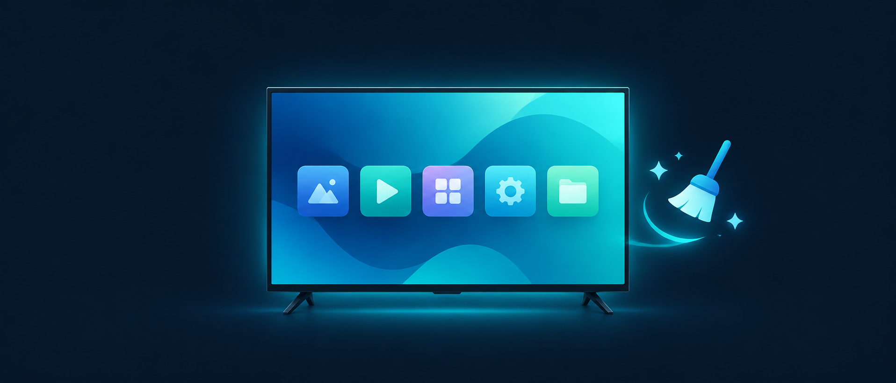

  

# VIDAA Clean TV

[English](README.md) | Español | [Preguntas frecuentes](FAQ.es.md)

Guías de ajustes de privacidad y filtrado DNS para televisores con VIDAA,
y herramientas sin conexión para revisar registros DNS. El objetivo es reducir
publicidad y telemetría sin root ni cambios de firmware.

**Solo hay una sesión DNS comunicada por un propietario: Hisense 65A67H.
Ningún modelo tiene todavía una sesión completa de ajustes registrada.** Los
menús y resultados dependen del modelo, la región y el firmware. Consulta el
[registro de pruebas](TESTING.md), no lo tomes como una certificación.

## Por qué existe este proyecto

Clean Your TV desactiva paquetes Android mediante ADB. Ese procedimiento no
está documentado para los VIDAA no Android cubiertos aquí. Por eso trabajamos
con ajustes normales del televisor y filtrado DNS, no con paquetes ni firmware.
La marca por sí sola no identifica el sistema: algunos Hisense usan Android.
Consulta la [guía de compatibilidad](docs/07-compatibility.md) antes de seguir
pasos de otro modelo.

## Cómo funciona

| Paso | Qué hace | Límite |
|---|---|---|
| Ajustar | Buscar opciones documentadas de reconocimiento de contenido, datos de uso y personalización | Los nombres y efectos requieren comprobación en tu televisor. Anota el valor original. |
| Filtrar | Usar un filtro DNS para bloquear la resolución de determinados dominios | Puede afectar funciones necesarias; no modifica el software del televisor. |
| Observar | Consultar las peticiones DNS del televisor antes de añadir reglas | Un nombre de dominio no demuestra por sí solo qué datos transmite. |

No instalamos nada en el televisor. Los ajustes se revierten desde sus menús;
el filtrado se revierte retirando las reglas o la configuración DNS. Esto no
promete ausencia total de anuncios o de seguimiento.

## Por dónde empezar

Las guías detalladas enlazadas a continuación siguen en inglés.

| Situación | Guía |
|---|---|
| Solo tienes el mando | [Ajustes del televisor](docs/01-on-device-settings.md) |
| Tienes un ordenador siempre encendido o una Raspberry Pi | [Filtrado DNS](docs/02-dns-filtering.md) y [observación](docs/03-observing-dns.md) |
| Vas a probar un VIDAA por primera vez | [Protocolo de primera sesión](docs/05-first-hardware-session.md) |
| Quieres probar las herramientas sin televisor ni red | [Ejemplo sintético sin conexión](docs/06-offline-example.md) |
| Te preocupa que deje de funcionar una aplicación | [Compatibilidad por aplicación](docs/08-app-compatibility.md) y [solución de problemas](TROUBLESHOOTING.md) |

Si la red es compartida, no cambies su DNS sin el acuerdo de las personas
que puedan verse afectadas. Limita el filtro al televisor cuando sea posible.

## Qué está documentado y qué está probado

| Plataforma | Estado |
|---|---|
| Hisense VIDAA | Ajustes, DNS y observación documentados. Una sesión DNS comunicada en un 65A67H; no valida todos los modelos ni los menús de ajustes. |
| Toshiba VIDAA | Ajustes y DNS documentados. El Toshiba 50UV1553DB sigue pendiente de su primera sesión registrada. |
| Android TV / Google TV, incluidos Hisense con Android | Consulta [Clean Your TV](https://github.com/Gathin23/cleanyourtv); no apliques estas guías como si los sistemas fueran iguales. |
| Samsung Tizen / LG webOS | Sistemas distintos, fuera del ámbito de estas guías. |

Consulta las [fichas por modelo](docs/tv/README.md) y el
[registro de pruebas](TESTING.md). El control local MQTT es una
[nota de investigación](docs/04-local-control-mqtt.md), no una función
verificada aquí para el Toshiba.

## Documentación

- [Preguntas frecuentes en español](FAQ.es.md).
- [Compatibilidad por sistema y función](docs/07-compatibility.md).
- [Compatibilidad por aplicación y límites de la evidencia](docs/08-app-compatibility.md).
- [Problemas y recuperación](TROUBLESHOOTING.md).
- [Cómo contribuir e informar de un modelo](CONTRIBUTING.md).
- [Historial de cambios](CHANGELOG.md).

## Qué no hace

No ofrece ADB, instalación de APK, cambio de launcher ni desactivación de
paquetes. Tampoco root, cambios de firmware ni menús de fábrica o de servicio.
Los proyectos externos de modificación nativa son otra vía y no están
cubiertos por nuestras instrucciones de recuperación.

## Fuentes y créditos

- [Gathin23/cleanyourtv](https://github.com/Gathin23/cleanyourtv), MIT: inspiración y guía para sistemas no Android; no copiamos su código.
- [IPanalytics](https://github.com/ipanalytics/Hisense-VIDAA-DNS-Clean-TV-Blocklist), Apache-2.0: lista DNS a la que nos suscribimos, no una copia incluida. La [instantánea fechada](docs/02-dns-filtering.md#upstream-snapshot-11-november-2026) explica sus cambios y el compromiso con Prime Video.
- [OliverS45](https://github.com/HALCONDEORO/vidaa-clean-tv/pull/31): sesión DNS del Hisense 65A67H y solución de problemas de configuración, incorporadas con autoría.
- [warrenrees/ha_vidaatv](https://github.com/warrenrees/ha_vidaatv), MIT: fuente sobre control local MQTT.
- [justatv.eu](https://justatv.eu/en/guides/cleaning-up-a-hisense-television-with-vidaa) y [política de privacidad de VIDAA](https://www.vidaa.com/os-privacy-policy/): fuentes de los ajustes.

Los créditos completos están en [NOTICE.md](NOTICE.md). Proyecto independiente,
sin afiliación ni aprobación de los fabricantes.

## Desarrollo y licencia

La batería sin conexión se ejecuta con
`python3 -m unittest discover -s scripts -p 'test_*.py' -v`.
Las herramientas usan la biblioteca estándar de Python. CI comprueba las
pruebas en Python 3.10-3.14, los enlaces y el suplemento frente a la lista
original. Los requisitos para contribuir están en [CONTRIBUTING.md](CONTRIBUTING.md).

Contenido original bajo [MIT](https://github.com/HALCONDEORO/vidaa-clean-tv/blob/main/LICENSE). Cada proyecto externo conserva su licencia.

## Mantenimiento de esta versión

Versión española revisada frente a README.md de `46ec5d1`, 14 de noviembre de
2026. Es una adaptación de lectura, no una traducción de todas las guías.
Cuando cambien los pasos, el estado de pruebas o los avisos en inglés, debe
revisarse también esta página y [FAQ.es.md](FAQ.es.md). Si detectas una
diferencia, comprueba la evidencia enlazada y comunícala; no supongas que la
versión más optimista es la correcta.
