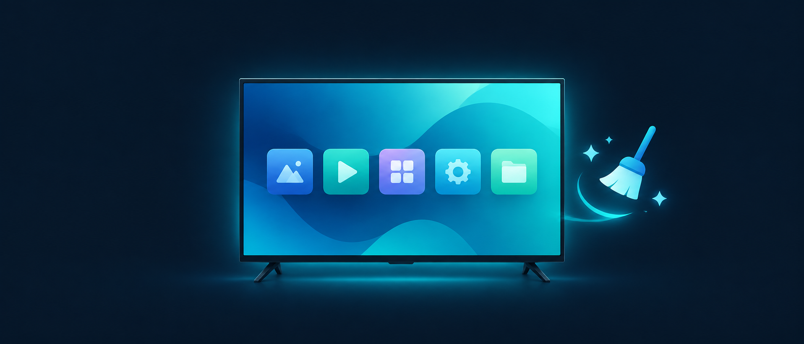

  

# VIDAA Clean TV

Reversible cleanup for smart TVs running VIDAA (Hisense, Toshiba and other VIDAA brands): fewer ads and recommendation tiles on the home screen, less telemetry, and content recognition (ACR) turned off. No rooting, no firmware changes, nothing that touches the system.

## Why a separate project

Clean Your TV and similar tools disable packages over ADB. VIDAA has no ADB, no sideloading and no reachable package list, so that approach cannot be ported: [Clean Your TV's Hisense compatibility page](https://cleanyourtv.wiki/tv/hisense/) lists sets running VIDAA OS as not covered because the tool needs Android, and the [justatv.eu VIDAA guide](https://justatv.eu/en/guides/cleaning-up-a-hisense-television-with-vidaa) reaches the same conclusion - with no ADB on VIDAA, cleanup means settings and network filtering, not package tools. A port would not be an adaptation, it would be a different tool. This is that tool.

## How it works

VIDAA sets have no debug bridge, so the cleanup happens where the system does allow it: in the TV's own settings and on the network the TV talks to.

| Step | What happens |
|---|---|
| **Settings** | A five-minute pass with the remote turns off content recognition (ACR), usage data and personalized ads. Fully reversible. |
| **Filter** | A DNS filter on your network stops ad and telemetry domains from resolving. The TV itself is never modified. |
| **Observe** | The filter's query log shows what your TV actually talks to, so new block rules come from evidence, not guesses. |

**No root, no firmware changes, nothing installed on the TV, and everything can be undone.**

## Quick start

| You have | Do this |
|---|---|
| **Just the remote** | [docs/01-on-device-settings.md](docs/01-on-device-settings.md) - about five minutes; local settings you can change back. |
| **An always-on computer or Raspberry Pi** | Add [docs/02-dns-filtering.md](docs/02-dns-filtering.md) and [docs/03-observing-dns.md](docs/03-observing-dns.md). |
| **A VIDAA TV you are cleaning for the first time** | Follow [docs/05-first-hardware-session.md](docs/05-first-hardware-session.md) and log what you see. |

## What you get

| Part | What it looks like |
|---|---|
| **Content recognition off** | The TV stops reporting what you watch - over apps, HDMI and broadcast alike. |
| **Ads without a profile of you** | Ads can still appear. The documented personalization toggle can be disabled; its effect has not been verified on the target TV. |
| **A cleaner home screen (DNS route)** | The upstream blocklist author reports recommendation rows, promo tiles and VIDAA Free promos gone, with YouTube and Netflix intact. |
| **A test log, not promises** | [TESTING.md](TESTING.md) records exactly what was verified, on which model and when. Nothing else is claimed. |

## Supported TVs

Anything running **VIDAA** - sold as VIDAA or, on the newest sets, as HomeOS, which is the same system under a new name.

| Platform | What works |
|---|---|
| **Hisense VIDAA** | All three routes. The upstream DNS blocklist is tested on Hisense sets in Europe by its author. |
| **Toshiba VIDAA** | Route 1 by design (the settings are VIDAA's own); routes 2 and 3 pending the first hardware test on a Toshiba 50UV1553DB. |
| **Android TV / Google TV sets, including Hisense models that actually run Android** | You want [Clean Your TV](https://github.com/Gathin23/cleanyourtv) instead - this project does not apply to Android. |
| **Samsung (Tizen), LG (webOS)** | Different systems entirely; nothing here applies. |

Per-model pages live under [docs/tv/](docs/tv/): [Toshiba 50UV1553DB](docs/tv/toshiba-50uv1553db.md) and [Hisense VIDAA](docs/tv/hisense.md).

## Documentation

| Doc | What it covers |
|---|---|
| [docs/01-on-device-settings.md](docs/01-on-device-settings.md) | Route 1: the reversible settings pass |
| [docs/02-dns-filtering.md](docs/02-dns-filtering.md) | Route 2: DNS filtering setup, options and honest warnings |
| [docs/03-observing-dns.md](docs/03-observing-dns.md) | Route 3: observing DNS and building your own rules |
| [docs/04-local-control-mqtt.md](docs/04-local-control-mqtt.md) | Note on the local MQTT control interface |
| [docs/05-first-hardware-session.md](docs/05-first-hardware-session.md) | Protocol for the first real cleanup session |
| [TROUBLESHOOTING.md](TROUBLESHOOTING.md) | When something breaks or does not match the docs |

## What this project does NOT do

- No ADB, no APK sideloading, no launcher replacement, no package disabling. VIDAA does not offer any of these.
- No firmware modification, no factory or service menus, no rooting. Those risk bricking the set and voiding the warranty.
- No invented APIs. Every step is either a documented on-device setting or standard network administration.

## Existing work this builds on

- [Gathin23/cleanyourtv](https://github.com/Gathin23/cleanyourtv) (MIT) - ADB-based cleanup for Android TV / Google TV. Not compatible with VIDAA. Inspiration for the goal; none of the code.
- [ipanalytics/Hisense-VIDAA-DNS-Clean-TV-Blocklist](https://github.com/ipanalytics/Hisense-VIDAA-DNS-Clean-TV-Blocklist) (Apache-2.0) - the blocklist this project subscribes to: 137 active rules observed on real Hisense VIDAA sets in Europe. We do not copy the list; we point at it and keep a small supplement for domains observed on other VIDAA brands.
- [warrenrees/ha_vidaatv](https://github.com/warrenrees/ha_vidaatv) (MIT) - Home Assistant integration that talks to VIDAA TVs over MQTT with on-screen PIN pairing, and lists some Toshiba VIDAA sets as supported. See [docs/04-local-control-mqtt.md](docs/04-local-control-mqtt.md).
- [justatv.eu VIDAA cleanup guide](https://justatv.eu/en/guides/cleaning-up-a-hisense-television-with-vidaa) and the [official VIDAA OS privacy policy](https://www.vidaa.com/os-privacy-policy/) - sources for the settings paths in docs/01.

## Development

`python3 scripts/test_classify_dns_log.py -v` runs the offline test suite (stdlib only). CI runs it, plus a syntax and duplicate validation of the supplement blocklist, on every push and pull request across Python 3.10-3.13.

## Hardware verification status

Nothing here is claimed as tested on a specific model until it appears in [TESTING.md](TESTING.md) with a date and a firmware version. The current target device is a Toshiba 50UV1553DB (VIDAA, Europe). Until that first session is logged, treat every menu name as "wording varies - read the privacy section".

## License

MIT for original content (see LICENSE). Third-party projects keep their own licenses (see NOTICE.md).
